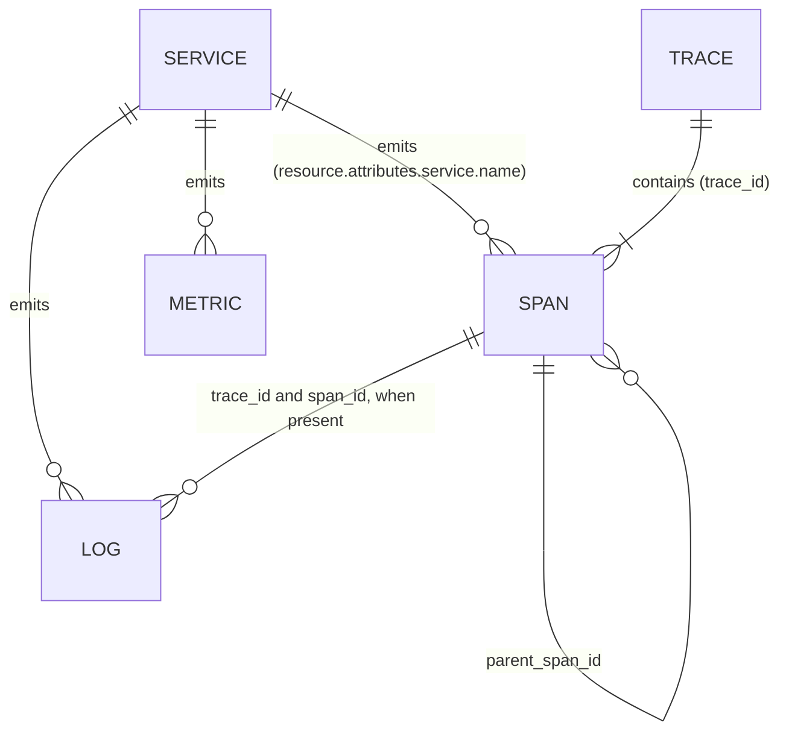

# Data schema

This page describes the data that Sherlog's agent reads. It lives in Elasticsearch and comes from the
[OpenTelemetry Demo](opentelemetry.md). Elasticsearch keeps each kind of data in a **data stream**: a named
group of indices that keeps growing over time. The agent's tools write their ES|QL queries against the names
and fields listed here.

## The three kinds of data

| Data stream | What it holds | Key fields |
|---|---|---|
| `traces-generic.otel-default` | One document per **span** (one step of a request) | `@timestamp`, `trace_id`, `span_id`, `parent_span_id`, `name`, `kind`, `duration`, `status.code`, `resource.attributes.service.name` |
| `logs-generic.otel-default` | One document per **log line** | `@timestamp`, `body.text`, `trace_id`, `span_id`, `resource.attributes.service.name` |
| `metrics-*` (several data streams) | One document per **measurement** | `@timestamp`, `unit`, `metrics.<name>`, `resource.attributes.service.name` |

The metrics are split into several data streams, named after the part that produced them:
`metrics-generic.otel-default` (the shop's own services), and `metrics-hostmetricsreceiver`,
`metrics-dockerstatsreceiver`, `metrics-postgresqlreceiver`, `metrics-redisreceiver`,
`metrics-nginxreceiver`, `metrics-httpcheckreceiver`, `metrics-prometheusreceiver` and
`metrics-collectortelemetry` (all with the suffix `.otel-default`). Each measurement's value sits in a field
called `metrics.<its name>`, for example `metrics.demo.payment.transactions`. To query all of them at once,
use `FROM metrics-*`.

The collector's own log lines go to `logs-collectortelemetry.otel-default`.

## How the data connects



- A **trace** is the path of one request. It is made of spans, and spans form a tree through `parent_span_id`.
- A **log line** written while a span was active carries the same `trace_id` and `span_id`. This is how you
  jump from a slow or failed span to the log lines around it.
- Everything is tied to a **service** through `resource.attributes.service.name`. A service is not a data
  stream of its own, it is a value of that field.

## Example documents

Trimmed to the key fields. Real documents have many more, mostly about the process and the host.

**A span** (`traces-generic.otel-default`)

```json
{
  "@timestamp": 1791959277653,
  "trace_id": "a9bddd96616631f7971bffdb34a3c267",
  "span_id": "44fde2d985d029de",
  "parent_span_id": "0667def82e6ab450",
  "name": "oteldemo.CartService/AddItem",
  "kind": "Client",
  "duration": 41674875,
  "status": {},
  "attributes": { "rpc.method": "AddItem", "server.address": "cart" },
  "resource": { "attributes": { "service.name": "frontend" } }
}
```

**A log line** (`logs-generic.otel-default`)

```json
{
  "@timestamp": 1792001692103,
  "trace_id": "c50497410abaf70f2fd4cb1ee0fa26e0",
  "span_id": "2ed10a51a62ed583",
  "event_name": "cart.get",
  "body": { "text": "GetCartAsync called with userId={userId}" },
  "resource": { "attributes": { "service.name": "cart" } }
}
```

**A measurement** (`metrics-generic.otel-default`)

```json
{
  "@timestamp": 1792001663619,
  "unit": "{transaction}",
  "attributes": { "demo.payment.currency": "CAD" },
  "metrics": { "demo.payment.transactions": 114 },
  "resource": { "attributes": { "service.name": "payment" } }
}
```

## Facts about the fields

- **`duration`** is in **nanoseconds**. `100000000` is 0.1 seconds.
- **`kind`** is `Server` (the service received a request), `Client` (it made a call to another service) or
  `Internal` (work inside the service).
- **`status.code`** is empty for most spans, `Ok` for some, and `Error` for a very small number (64 of about
  586,000 when this was written). Error spans are rare, which makes them a strong signal.
- **`@timestamp`** is stored as milliseconds since 1970. In ES|QL it behaves as a date, so
  `@timestamp > NOW() - 5 minutes` works.
- **Services** seen in traces: 17. In logs: 15. `frontend-web` is the shop's code running in the browser.
  The databases (`astronomy-db`, `valkey-cart`) have no traces, you see them through the PostgreSQL and
  Redis metrics.

## Example queries

Spans per service:

```text
FROM traces-generic.otel-default
| STATS spans = COUNT(*) BY resource.attributes.service.name
| SORT spans DESC
```

Latency per service, computed from span durations (see the limits below):

```text
FROM traces-generic.otel-default
| WHERE kind == "Server"
| STATS p50 = PERCENTILE(duration, 50), p95 = PERCENTILE(duration, 95) BY resource.attributes.service.name
| SORT p95 DESC
```

Failed spans per service:

```text
FROM traces-generic.otel-default
| WHERE status.code == "Error"
| STATS errors = COUNT(*) BY resource.attributes.service.name
| SORT errors DESC
```

## Known limits

1. **There are no request-duration metrics.** The Elasticsearch exporter drops histograms sent in the
   cumulative format, and the demo sends all of them that way. Latency is computed from span durations
   instead, as in the query above. The exporter marks its metrics support as still in development.
2. **Older data says `service.version` 3.0.0**, newer data says 3.1.0. The demo's own settings mixed the two,
   and `demo/.env.override` now sets the right one.
3. **The `agent` service is a stub** and produces no spans (see [opentelemetry.md](opentelemetry.md)).
4. **There are error spans even with every feature flag off.** The most frequent ones come from
   `flagd.evaluation.v2.Service/EventStream` (the long-lived connection to the feature flag service) and from
   `GET` requests in `frontend-proxy`. The cause has not been checked yet, so treat them as background noise
   until it is.

## Not defined yet

The shape of an investigation, a signal and an evaluation result will be added in Phases 3 and 5. The
TypeScript types will be the source of truth, and this page will explain them.
